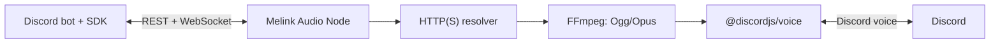

<p align="center">
  
</p>

<h1 align="center">Melink Audio Node</h1>

<p align="center">
  A self-hosted Discord voice node for direct HTTP audio streams.<br>
  Built by <strong>Melow Studio</strong>.
</p>

<p align="center">
  
  
  
</p>

> **Early-stage project:** Melink Audio Node is not a drop-in Lavalink replacement. It currently accepts direct, publicly reachable HTTP(S) media URLs; it does not search music platforms.

## What it is

Melink Audio Node is a small Node.js service that lets a Discord bot delegate
voice playback to a separate process. The bot controls the node over an
authenticated REST API and WebSocket connection. The node joins Discord voice,
streams a direct media URL through FFmpeg, and sends Ogg/Opus audio to Discord.

The project is designed to be understandable and hackable—not to promise
unverified RAM, CPU, latency, or availability figures.

### Current capabilities

- One isolated player per Discord guild, scoped to an authenticated client session.
- REST endpoints for sessions, direct-URL track loading, player controls, and basic stats.
- A WebSocket bridge for Discord voice gateway payloads and player events.
- FFmpeg-based conversion to 48 kHz stereo Opus in an Ogg container.
- Configurable per-session player limit and idle-player cleanup.
- Public-address checks for media hosts, including redirect targets.

### Not implemented yet

- Search terms or platform resolvers for YouTube, Spotify, SoundCloud, and similar services.
- Lavalink protocol compatibility.
- Playlists, a server-side queue, filters, caching, automatic source fallback, or a dashboard.
- Persistent sessions or multi-process clustering.

## How it fits together



See [Architecture](docs/architecture.md) for the component and lifecycle details.

## Quick start

### Requirements

- Node.js **22.12 or newer**.
- FFmpeg with the `libopus` encoder, provided by `ffmpeg-static` when its
  install script is permitted or by a system `ffmpeg` on `PATH`.
- A host that allows persistent processes and outbound UDP for Discord voice.
- A publicly reachable HTTPS endpoint for production deployments.
- Direct media URLs that the node can access without browser cookies or interactive sign-in.

### Run the node

```powershell
Copy-Item .env.example .env
```

On macOS or Linux:

```bash
cp .env.example .env
```

Set a unique `AUDIO_NODE_TOKEN` in `.env`, then install and start:

```powershell
npm ci
npm start
```

The service listens on `0.0.0.0:2333` by default. Check
`http://localhost:2333/healthz` for the process health response.

For Docker:

```powershell
docker build -t melink-audio-node .
docker run --name melink-audio-node --restart unless-stopped `
  --env-file .env -p 2333:2333 melink-audio-node
```

The same Docker commands work in a POSIX shell without the PowerShell
continuation character:

```bash
docker build -t melink-audio-node .
docker run --name melink-audio-node --restart unless-stopped \
  --env-file .env -p 2333:2333 melink-audio-node
```

Discord voice requires outbound UDP. Publishing the HTTP API port does not
replace that host/network requirement. See [Deployment](docs/deployment.md).

## Connect a Discord bot

The published SDK is `melink-audio-node-client`; its source is included in
[`packages/audio-node-client`](packages/audio-node-client/README.md).

```bash
npm install melink-audio-node-client
```

```js
import { AudioNodeClient } from 'melink-audio-node-client';

const audio = new AudioNodeClient({
  baseUrl: process.env.AUDIO_NODE_URL,
  token: process.env.AUDIO_NODE_TOKEN,
  discordClient: client,
});

audio.on('TrackStartEvent', ({ guildId, track }) => {
  console.log(`Audio Node started ${track.title} in ${guildId}`);
});
audio.on('error', (error) => console.error('Audio Node:', error.message));

await audio.connect();
await audio.join(guildId, voiceChannelId);
const loaded = await audio.loadTracks('https://cdn.example.net/audio.mp3');
await audio.play(guildId, loaded.tracks[0]);
```

The SDK expects a discord.js v14 client. `AUDIO_NODE_URL` is the HTTPS origin
only—do not append `/healthz` or `/v1`. See the [bot integration guide](docs/bot-integration.md)
for lifecycle cleanup, event handling, and CommonJS notes.

## Configuration

| Variable | Default | Description |
| --- | --- | --- |
| `HOST` | `0.0.0.0` | Interface to bind the HTTP server to. |
| `PORT` | `2333` | Listening port; takes precedence over `SERVER_PORT`. |
| `SERVER_PORT` | — | Hosting-provided port used when `PORT` is unset. |
| `AUDIO_NODE_TOKEN` | — | Required node credential; use a random value of at least 24 characters. |
| `MAX_PLAYERS` | `5` | Maximum simultaneous players per client session. |
| `IDLE_TIMEOUT_MS` | `30000` | Time before an idle player is destroyed. |
| `LOG_LEVEL` | `info` | Reserved configuration value; current logs use Node's console methods. |

More detail and safe token-generation commands are in [Configuration](docs/configuration.md).

## API overview

All REST endpoints except `GET /healthz` require a bearer token. The node token
creates client sessions and reads node stats; each session receives a separate
session token for player and track requests.

| Method | Path | Purpose |
| --- | --- | --- |
| `GET` | `/healthz` | Unauthenticated process health check. |
| `POST` | `/v1/sessions` | Create a session using the node token. |
| `GET` | `/v1/stats` | Read basic process and player stats using the node token. |
| `DELETE` | `/v1/sessions/{sessionId}` | Close a session using its session token. |
| `POST` | `/v1/sessions/{sessionId}/loadtracks` | Resolve one direct HTTP(S) URL. |
| `POST` | `/v1/sessions/{sessionId}/players/{guildId}` | Join voice or stop playback. |
| `PATCH` | `/v1/sessions/{sessionId}/players/{guildId}` | Play or pause. |
| `GET` / `DELETE` | `/v1/sessions/{sessionId}/players/{guildId}` | Read or destroy a player. |
| `WS` | `/v1/ws` | Authenticate a session and exchange voice/player events. |

Full request examples, authentication, and WebSocket packet names are in the
[API reference](docs/api.md).

## Security and deployment notes

- Keep the node token in your host's secret environment settings. Never commit
  `.env`, deployment exports, npm credentials, or `node_modules`.
- Put the API behind HTTPS and restrict access to trusted bot clients. The
  service has authentication but does not currently implement per-IP rate
  limiting or persistent session storage.
- Media URLs are fetched by the node. Only accept URLs from trusted users and
  use media you are authorized to stream.
- Health checks do not prove that Discord voice, FFmpeg, or a particular media
  URL is working.

See [Security](SECURITY.md) before exposing an instance to the internet.

## Development

```powershell
npm ci
npm test
```

Tests use Node's built-in test runner and local ephemeral HTTP/WebSocket servers.
They do not connect to Discord or exercise a live FFmpeg playback session.
Contribution steps are in [CONTRIBUTING.md](CONTRIBUTING.md).

## Roadmap

The current release focuses on a small, inspectable playback node. Potential
future work includes resolver plugins, richer metrics, a formal API schema,
more lifecycle tests, and an operator dashboard. These are ideas, not existing
features or compatibility promises.

## License

Melink Audio Node is dual-licensed under **GNU GPL v3.0 only OR GNU AGPL v3.0
only**, at the recipient's choice. This is an alternative, not a requirement
to comply with both licenses. See [LICENSE](LICENSE),
[LICENSE-GPL-3.0](LICENSE-GPL-3.0), and [LICENSE-AGPL-3.0](LICENSE-AGPL-3.0).

If you choose the AGPL option and deploy a modified version that supports
remote network interaction, AGPL section 13 requires a prominent, no-charge
offer of that version's corresponding source to its remote users. Choosing the
GPL option does not add that network-use requirement. See
[Licensing](docs/licensing.md) for details, and the
[dependency license review](docs/dependency-licenses.md) for the current
third-party metadata snapshot.

The SDK's previously published `0.1.0` package remains GPL-3.0-only. The
dual-license metadata is prepared for SDK `0.1.1`; that version has not been
published.

Copyright (C) 2026 Melow Studio.
