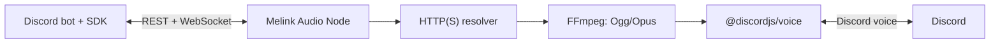

<p align="center">
  
</p>

<h1 align="center">Melink Audio Node</h1>

<p align="center">
  A self-hosted Discord voice node for direct HTTP audio and authorized SoundCloud streams.<br>
  Built by <strong>Melow Studio</strong>.
</p>

<p align="center">
  
  
  
</p>

> **Early-stage project:** Melink Audio Node is not a drop-in Lavalink replacement. It accepts direct, publicly reachable HTTP(S) media URLs and can search configured provider catalogs. YouTube and Spotify search results are metadata only; SoundCloud playback requires an officially authorized stream.

## What it is

Melink Audio Node is a small Node.js service that lets a Discord bot delegate
voice playback to a separate process. The bot controls the node over an
authenticated REST API and WebSocket connection. The node joins Discord voice,
streams a direct media URL through FFmpeg, and sends Ogg/Opus audio to Discord.

The project is designed to be understandable and hackable—not to promise
unverified RAM, CPU, latency, or availability figures.

### Current capabilities

- One isolated player per Discord guild, scoped to an authenticated client session.
- REST endpoints for sessions, direct-URL track loading, player controls, and basic stats.
- A WebSocket bridge for Discord voice gateway payloads and player events.
- FFmpeg-based conversion to 48 kHz stereo Opus in an Ogg container.
- Configurable per-session player limit and idle-player cleanup.
- Public-address checks for media hosts, including redirect targets.
- A resolver plugin interface with the direct HTTP(S) resolver built in.
- A capability-validated Source Manager and versioned Plugin Manager for explicitly configured npm packages.
- Playback position tracking, output volume, ten validated FFmpeg filters, and ordered plugin-provided playlists. Resolved tracks are currently reported as non-seekable because ranged seeking is not implemented.
- Parallel multi-source catalog search across enabled, configured providers, including plugin sources. YouTube and Spotify remain metadata-only; only sources that advertise playback can return playable tracks.
- Structured logs, request IDs, API rate limits, and bounded startup retries.
- Protected Prometheus metrics, readiness checks, and an experimental
  Lavalink v4-style control plane. Its discovery, loadtracks, voice handoff,
  and basic Shoukaku 4.3.0 player commands are integration-tested with a
  fixture player.

### Not implemented yet

- YouTube/Spotify audio playback; their official APIs provide metadata, not audio streams.
- Full Lavalink v4 compatibility. Track end-time limits, server-side queues,
  caching, and a dashboard are not implemented. Live Discord/FFmpeg playback
  through a Lavalink client is not validated.
- Playlist providers must be supplied by a source plugin; built-in providers
  do not advertise playlist support. Seek likewise requires the active provider
  to mark its track seekable.
- Persistent sessions or multi-process clustering.

## How it fits together



See [Architecture](docs/architecture.md), the [source plugin guide](docs/plugins.md),
[legacy resolver guide](docs/resolvers.md),
[Lavalink compatibility limits](docs/lavalink-compat.md), and the
[OpenAPI schema](docs/openapi.json) for implementation details. The
[performance guide](docs/performance.md) explains the benchmark's limits.

## Quick start

### Requirements

- Node.js **22.12 or newer**.
- FFmpeg with the `libopus` encoder, provided by `ffmpeg-static` when its
  install script is permitted or by a system `ffmpeg` on `PATH`.
- A host that allows persistent processes and outbound UDP for Discord voice.
- A publicly reachable HTTPS endpoint for production deployments.
- Direct media URLs that the node can access without browser cookies or interactive sign-in.
- Provider API credentials for the catalogs you want to search; see [Configuration](docs/configuration.md).

> **Hosting/VDS requirement:** The Audio Node host must allow outbound UDP to
> Discord voice, keep the process running, and provide FFmpeg with `libopus`.
> If the provider blocks UDP or does not allow FFmpeg to run, the bot may
> connect or show a track as playing, but no audio will be heard. Opening the
> HTTP API port or passing `/healthz` alone does not verify voice playback.

### Run the node

```powershell
Copy-Item .env.example .env
```

On macOS or Linux:

```bash
cp .env.example .env
```

Set a unique `AUDIO_NODE_TOKEN` in `.env`, then install and start:

```powershell
npm ci
npm start
```

The service listens on `0.0.0.0:2333` by default. Check
`http://localhost:2333/healthz` for process liveness and `/readyz` for
readiness. Prometheus scrapers can fetch `/metrics` using the node token.

For Docker:

```powershell
docker build -t melink-audio-node .
docker run --name melink-audio-node --restart unless-stopped `
  --env-file .env -p 2333:2333 melink-audio-node
```

The same Docker commands work in a POSIX shell without the PowerShell
continuation character:

```bash
docker build -t melink-audio-node .
docker run --name melink-audio-node --restart unless-stopped \
  --env-file .env -p 2333:2333 melink-audio-node
```

Discord voice requires outbound UDP. Publishing the HTTP API port does not
replace that host/network requirement. See [Deployment](docs/deployment.md).

## Connect a Discord bot

The published SDK is `melink-audio-node-client`; its source is included in
[`packages/audio-node-client`](packages/audio-node-client/README.md).

```bash
npm install melink-audio-node-client
```

```js
import { AudioNodeClient } from 'melink-audio-node-client';

const audio = new AudioNodeClient({
  baseUrl: process.env.AUDIO_NODE_URL,
  token: process.env.AUDIO_NODE_TOKEN,
  discordClient: client,
});

audio.on('TrackStartEvent', ({ guildId, track }) => {
  console.log(`Audio Node started ${track.title} in ${guildId}`);
});
audio.on('error', (error) => console.error('Audio Node:', error.message));

await audio.connect();
await audio.join(guildId, voiceChannelId);
const loaded = await audio.loadTracks('https://cdn.example.net/audio.mp3');
await audio.play(guildId, loaded.tracks[0]);

const results = await audio.searchTracks('ambient music', { limit: 10 });
const playable = results.tracks.find((track) => track.playable);
if (playable) {
  const resolved = await audio.loadTracks(playable.info.uri || playable.info.identifier);
  await audio.play(guildId, resolved.tracks[0]);
}

// Legacy single-source searches remain supported:
// Legacy single-source calls remain supported; SoundCloud must be enabled.
const soundcloudResults = await audio.searchTracks('soundcloud', 'ambient music');
```

The SDK expects a discord.js v14 client. `AUDIO_NODE_URL` is the HTTPS origin
only—do not append `/healthz` or `/v1`. See the [bot integration guide](docs/bot-integration.md)
for lifecycle cleanup, event handling, and CommonJS notes.

## Configuration

| Variable | Default | Description |
| --- | --- | --- |
| `HOST` | `0.0.0.0` | Interface to bind the HTTP server to. |
| `PORT` | `2333` | Listening port; takes precedence over `SERVER_PORT`. |
| `SERVER_PORT` | — | Hosting-provided port used when `PORT` is unset. |
| `AUDIO_NODE_TOKEN` | — | Required node credential; use a random value of at least 24 characters. |
| `MAX_PLAYERS` | `5` | Maximum simultaneous players per client session. |
| `IDLE_TIMEOUT_MS` | `30000` | Time before an idle player is destroyed. |
| `LOG_LEVEL` | `info` | Pino log level: `fatal`, `error`, `warn`, `info`, `debug`, `trace`, or `silent`. |
| `AUDIO_NODE_RESOLVERS` | — | Legacy resolver packages, each pinned as `package@x.y.z`. |
| `AUDIO_NODE_PLUGINS` | — | Trusted source-plugin packages, each pinned as `package@x.y.z`; see [plugin guide](docs/plugins.md). |
| `AUDIO_NODE_DISABLED_PLUGINS` | — | Comma-separated plugin IDs or exact package names to disable. |
| `AUDIO_NODE_DISABLED_SOURCES` | — | Comma-separated source IDs to disable. |
| `HTTP_ENABLED` | `true` | Enables direct HTTP(S) URL playback. |
| `SOUNDCLOUD_ENABLED` | `false` | Enables SoundCloud search and playback; requires its Client ID when enabled. |
| `SPOTIFY_ENABLED` | `true` | Enables Spotify catalog search when credentials are configured. |
| `YOUTUBE_ENABLED` | `true` | Enables YouTube metadata search when an API key is configured. |
| `SOURCE_REQUEST_TIMEOUT_MS` | `10000` | Timeout for a source provider operation. |
| `SOURCE_RETRIES` | `1` | Additional attempts for transient source failures; bounded to 0–3. |
| `SOURCE_FALLBACK_ENABLED` | `false` | Try another matching playback source after eligible provider errors. |
| `YOUTUBE_API_KEY` | — | Enables YouTube metadata search. |
| `SPOTIFY_CLIENT_ID` / `SPOTIFY_CLIENT_SECRET` | — | Enable Spotify metadata search. |
| `SOUNDCLOUD_CLIENT_ID` | — | Enables official SoundCloud search and stream resolution. |
| `SOUNDCLOUD_OAUTH_TOKEN` | — | Optional SoundCloud API OAuth token. |
| `RATE_LIMIT_WINDOW_MS` | `60000` | Rate-limit window duration in milliseconds. |
| `SESSION_CREATE_LIMIT` | `10` | Session creation requests allowed per HTTP peer address per window. |
| `SESSION_REQUEST_LIMIT` | `120` | Authenticated REST requests allowed per session per window. |

More detail and safe token-generation commands are in [Configuration](docs/configuration.md).

## API overview

All REST endpoints except `GET /healthz` require a bearer token. The node token
creates client sessions and reads node stats; each session receives a separate
session token for player and track requests.

| Method | Path | Purpose |
| --- | --- | --- |
| `GET` | `/healthz` | Unauthenticated process liveness check. |
| `GET` | `/readyz` | Unauthenticated readiness check. |
| `GET` | `/metrics` | Prometheus metrics; requires the node token. |
| `POST` | `/v1/sessions` | Create a session using the node token. |
| `GET` | `/v1/stats` | Read basic process and player stats using the node token. |
| `GET` | `/v1/sources` | List source capability and runtime status using the node token. |
| `DELETE` | `/v1/sessions/{sessionId}` | Close a session using its session token. |
| `POST` | `/v1/sessions/{sessionId}/search` | Search one provider or aggregate eligible configured catalogs. |
| `POST` | `/v1/sessions/{sessionId}/catalog` / `/metadata` | Resolve provider catalog entries or metadata. |
| `POST` | `/v1/sessions/{sessionId}/loadtracks` | Resolve one track or a supported playlist. |
| `POST` | `/v1/sessions/{sessionId}/players/{guildId}` | Join voice or stop playback. |
| `PATCH` | `/v1/sessions/{sessionId}/players/{guildId}` | Play or pause. |
| `GET` / `DELETE` | `/v1/sessions/{sessionId}/players/{guildId}` | Read or destroy a player. |
| `WS` | `/v1/ws` | Authenticate a session and exchange voice/player events. |

Full request examples, authentication, and WebSocket packet names are in the
[API reference](docs/api.md).

## Security and deployment notes

- Keep the node token in your host's secret environment settings. Never commit
  `.env`, deployment exports, npm credentials, or `node_modules`.
- Put the API behind HTTPS and restrict access to trusted bot clients. The
  service applies in-memory rate limits; session state and rate-limit counters
  are not shared across processes or persisted across restarts.
- Media URLs are fetched by the node. Only accept URLs from trusted users and
  use media you are authorized to stream.
- Health checks do not prove that Discord voice, FFmpeg, or a particular media
  URL is working.

See [Security](SECURITY.md) before exposing an instance to the internet.

## Development

```powershell
npm ci
npm test
```

Tests use Node's built-in test runner and local ephemeral HTTP/WebSocket servers.
They do not connect to Discord or exercise a live FFmpeg playback session.
Contribution steps are in [CONTRIBUTING.md](CONTRIBUTING.md).

## Roadmap

The current release focuses on a small, inspectable playback node. Potential
future work includes an operator dashboard and broader Lavalink player
compatibility. These are ideas, not existing features or compatibility promises.

## License

Melink Audio Node is dual-licensed under **GNU GPL v3.0 only OR GNU AGPL v3.0
only**, at the recipient's choice. This is an alternative, not a requirement
to comply with both licenses. See [LICENSE](LICENSE),
[LICENSE-GPL-3.0](LICENSE-GPL-3.0), and [LICENSE-AGPL-3.0](LICENSE-AGPL-3.0).

If you choose the AGPL option and deploy a modified version that supports
remote network interaction, AGPL section 13 requires a prominent, no-charge
offer of that version's corresponding source to its remote users. Choosing the
GPL option does not add that network-use requirement. See
[Licensing](docs/licensing.md) for details, and the
[dependency license review](docs/dependency-licenses.md) for the current
third-party metadata snapshot.

The SDK's previously published `0.1.0` package remains GPL-3.0-only. The
dual-license metadata is prepared for SDK `0.1.1`; that version has not been
published.

Copyright (C) 2026 Melow Studio.
