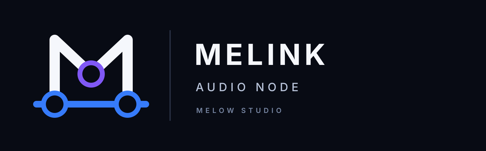

<p align="center">
  
</p>

# Melink Audio Node — Melow Studio

Discord botlarının ses oynatımını ayrı bir Node.js servisine devretmesi için
deneysel bir ses düğümü. Bot, node ile REST ve WebSocket üzerinden konuşur;
node HTTP(S) veya izinli SoundCloud akışını FFmpeg ile Ogg/Opus'a dönüştürüp
Discord ses kanalına aktarır.

> **Erken aşama:** Bu proje Lavalink'in yerine geçmez ve Lavalink protokolüyle
> tam uyumlu değildir. Doğrudan ve herkese açık HTTP(S) medya URL'lerinin yanı
> sıra yapılandırılmış sağlayıcılarda arama sunar. YouTube ve Spotify yalnızca
> metadata sağlar; SoundCloud oynatımı resmi API'nin izin verdiği akışlarla sınırlıdır.

## Neler var?

- İstemci oturumu başına guild bazında player.
- Oturum açma, URL yükleme, player kontrolü ve temel istatistikler için REST API.
- Discord voice gateway verileri ve olayları için WebSocket köprüsü.
- FFmpeg ile Ogg/Opus akışı; boş player'lar için zaman aşımıyla temizlik.
- İstemci oturumu başına ayarlanabilir player sınırı.
- API kimlik bilgileri yapılandırıldığında YouTube, Spotify ve SoundCloud kataloğunda arama.
- Yalnızca SoundCloud'un resmi API'sinin izin verdiği ses akışlarını oynatma.
- Deneysel Lavalink v4 kontrol katmanı; Shoukaku 4.3.0 ile temel player komutları test edilmiştir.
- Kaynak yeteneklerini doğrulayan Source Manager ve sürümlü Plugin Manager.
- Gerçek player position takibi, çıkış ses seviyesi, 10 FFmpeg filtresi ve
  eklentilerle sıralı playlist desteği. HTTP Range tabanlı seek henüz
  uygulanmadığı için çözümlenen parçalar seek edilebilir bildirilmez.

Tam Lavalink uyumluluğu, track end-time limitleri ve canlı Discord/FFmpeg
playback doğrulaması **henüz yoktur**. Playlist desteği, kaynağın ilgili
yetenekleri uygulamasına bağlıdır. Teknik ayrıntılar için İngilizce
[ana README](README.md) ve [dokümantasyon](docs/architecture.md) bölümüne bak.

## Hızlı başlangıç

Gereksinimler: Node.js 22.12+, sürekli çalışan bir sunucu ve Discord voice için
outbound UDP erişimi. **VDS sağlayıcısı outbound UDP'yi engelliyorsa veya
FFmpeg/libopus çalıştırmaya izin vermiyorsa bot bağlansa ve parça çalıyor
görünse bile ses gelmez.** HTTP portunun açık olması veya `/healthz` kontrolünün
başarılı olması ses aktarımını doğrulamaz. Ayrıntılar: [Deployment rehberi](docs/deployment.md).

```powershell
Copy-Item .env.example .env
```

`.env` içindeki `AUDIO_NODE_TOKEN` değerini benzersiz ve rastgele bir değerle
değiştir; sonra:

```powershell
npm ci
npm start
```

Varsayılan adres `0.0.0.0:2333`; sağlık kontrolü `GET /healthz`.
Değişkenler [configuration rehberinde](docs/configuration.md), API ise
[API referansında](docs/api.md) açıklanmıştır.

## Discord bot bağlantısı

```bash
npm install melink-audio-node-client
```

SDK örneği ve bot yaşam döngüsü [bot entegrasyon rehberinde](docs/bot-integration.md).
Üretimde API'yi HTTPS arkasında çalıştır; tokenları GitHub'a veya loglara koyma.

## Lisans ve katkı

Proje, alıcının tercihine göre **GNU GPL v3.0-only veya GNU AGPL v3.0-only**
lisanslarından biriyle sunulur; ikisinin aynı anda uygulanması gerekmez.
Ayrıntılar için [LICENSE](LICENSE), [GPL metni](LICENSE-GPL-3.0),
[AGPL metni](LICENSE-AGPL-3.0) ve [lisans rehberine](docs/licensing.md) bak.

AGPL seçeneğini tercih edip ağ üzerinden etkileşim sunan değiştirilmiş bir
sürümü çalıştıranlar, AGPL Bölüm 13 uyarınca o sürümün kaynak kodunu uzaktaki
kullanıcılara ücretsiz ve görünür biçimde sunmalıdır. GPL seçeneğinde bu ek
ağ şartı yoktur. SDK'nın daha önce yayımlanmış `0.1.0` sürümü GPL-3.0-only
olarak kalır; çift lisanslı `0.1.1` henüz yayımlanmamıştır.
Bağımlılık lisansları için [inceleme notlarına](docs/dependency-licenses.md)
bak.
