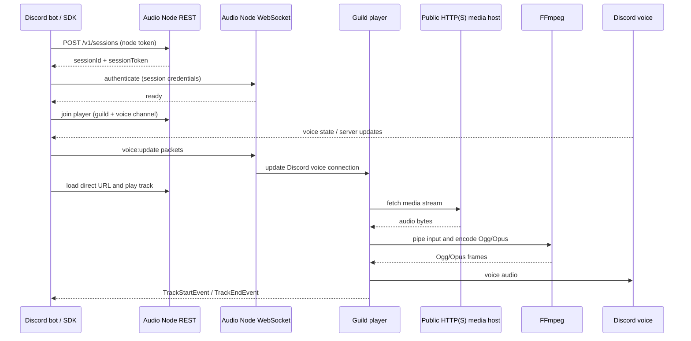

# Architecture

Melink Audio Node separates bot control from audio playback. A bot creates an
authenticated session over REST, keeps a WebSocket open for Discord voice
gateway payloads, and calls the player endpoints for each guild.

## Components

- **HTTP API:** Node's built-in `http` server handles health, session, stats,
  track-loading, and player operations.
- **Session manager:** Holds client sessions and guild players in process
  memory. Session credentials are random and compared in constant time.
- **WebSocket bridge:** Authenticates a session and relays Discord voice
  gateway payloads between the bot's discord.js adapter and the node's
  `@discordjs/voice` connection.
- **Resolver:** Accepts a direct HTTP(S) URL, resolves its public destination,
  and follows a limited number of redirects while revalidating each destination.
- **Audio pipeline:** Pipes the media response to FFmpeg stdin, encodes
  48 kHz stereo Opus in an Ogg container, and supplies it to
  `@discordjs/voice`.
- **FFmpeg discovery:** Uses the `ffmpeg-static` binary when present and falls
  back to `ffmpeg` from `PATH`.

## Runtime model and limits

- A session owns its players; player IDs are Discord guild IDs.
- `MAX_PLAYERS` applies per session, not across the whole process.
- Session and player state are not persisted across restarts.
- Idle players are destroyed after `IDLE_TIMEOUT_MS`.
- The current node has no distributed coordination or multi-process state.
- The current implementation does not search catalogs or maintain a queue.

## Playback data

The track's opaque `encoded` field contains the direct media URI as base64url
JSON. It is an API transport value, not encryption. Do not treat it as a
secret or use it to store credentials.

## Out of scope today

There is no Lavalink protocol compatibility, search provider, cache,
cross-source fallback engine, filter chain, or built-in dashboard. Those are
possible future projects, not current behavior.
