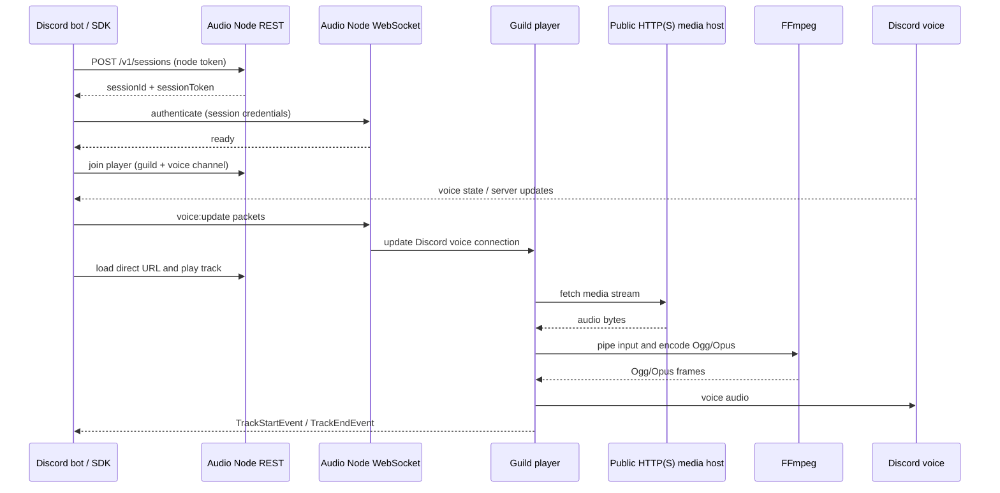

# Architecture

Melink Audio Node separates bot control from audio playback. A bot creates an
authenticated session over REST, keeps a WebSocket open for Discord voice
gateway payloads, and calls the player endpoints for each guild.

## Components

- **HTTP API:** Node's built-in `http` server handles health, session, stats,
  track-loading, and player operations.
- **Operations endpoints:** `/healthz` is liveness, `/readyz` is readiness, and
  token-protected `/metrics` exposes Prometheus text-format counters and gauges.
- **Lavalink compatibility:** An isolated experimental adapter supports
  discovery, stats, track loading, WebSocket events/resuming, voice handoff,
  and basic player controls. Its REST/WebSocket control flow is exercised with
  Shoukaku 4.3.0; it is not full Lavalink compatibility.
- **Session manager:** Holds client sessions and guild players in process
  memory. Session credentials are random and compared in constant time.
- **WebSocket bridge:** Authenticates a session and relays Discord voice
  gateway payloads between the bot's discord.js adapter and the node's
  `@discordjs/voice` connection.
- **Resolver registry:** Tries configured trusted npm resolver plugins, the
  built-in SoundCloud resolver, then the direct HTTP(S) resolver. SoundCloud
  streams are resolved through its official API only when authorized. Every
  resolved media URL still passes the core public-address and redirect checks
  when playback opens the stream. The first resolver claiming an identifier
  is used; failures are surfaced rather than silently falling back.
- **Catalog search:** Can query enabled, configured built-in and plugin search
  providers in parallel, isolate provider failures, and merge/deduplicate their
  results. YouTube and Spotify return metadata only; SoundCloud results are
  playable only when its official API authorizes a stream. Plugin capability
  declarations determine whether a provider may mark results playable.
- **Audio pipeline:** Pipes the media response to FFmpeg stdin, encodes
  48 kHz stereo Opus in an Ogg container, and supplies it to
  `@discordjs/voice`.
- **FFmpeg discovery:** Uses the `ffmpeg-static` binary when present and falls
  back to `ffmpeg` from `PATH`.

## Runtime model and limits

- A session owns its players; player IDs are Discord guild IDs.
- `MAX_PLAYERS` applies per session, not across the whole process.
- Session and player state are not persisted across restarts.
- Idle players are destroyed after `IDLE_TIMEOUT_MS`.
- The current node has no distributed coordination or multi-process state.
- Search results and provider credentials are not persisted; the SDK exposes
  catalog search and the node maintains no server-side queue.
- Rate limits are in-memory and reset on process restart; they are not shared
  between multiple node processes.

## Playback data

The track's opaque `encoded` field contains the direct media URI as base64url
JSON. It is an API transport value, not encryption. Do not treat it as a
secret or use it to store credentials.

## Out of scope today

There is no full Lavalink compatibility, YouTube/Spotify audio playback, cache,
cross-source fallback engine, filter chain, or built-in dashboard. Those are
possible future projects, not current behavior.
